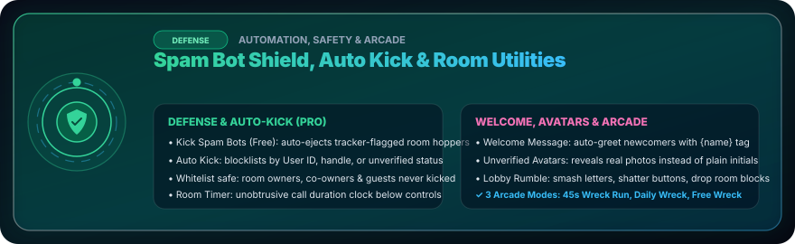

<!-- WEBSITE NAVIGATION BAR -->
<table>
  <tr>
    <td align="center">
      <a href="#overview"><b>Overview</b></a> &nbsp;&bull;&nbsp;
      <a href="#interface"><b>Interface</b></a> &nbsp;&bull;&nbsp;
      <a href="#insights"><b>Insights</b></a> &nbsp;&bull;&nbsp;
      <a href="#media-suite"><b>Media Suite</b></a> &nbsp;&bull;&nbsp;
      <a href="#persistence"><b>Persistence</b></a> &nbsp;&bull;&nbsp;
      <a href="#defense"><b>Defense</b></a> &nbsp;&bull;&nbsp;
      <a href="#comparison"><b>Matrix</b></a> &nbsp;&bull;&nbsp;
      <a href="#installation"><b>Install</b></a> &nbsp;&bull;&nbsp;
      <a href="#privacy"><b>Privacy</b></a>
    </td>
  </tr>
</table>

<!-- HERO SECTION: ANIMATED SVG BANNER WITH CIRCLE ANIMATION & COLOR CHANGING HEADER -->

  

<!-- DYNAMIC PRODUCT PILLS & BADGES -->

  
  
  
  
  

<!-- ACTION CALL-TO-ACTION BUTTONS -->

  
  &nbsp;&nbsp;
  

<!-- METRICS STRIP -->
<table>
  <tr>
    <td align="center" width="25%">
      <h3><code>200+</code></h3>
      
<b>Saved Room Chats</b> Persistent history archive

    </td>
    <td align="center" width="25%">
      <h3><code>100%</code></h3>
      
<b>Pro Features Unlocked</b> Zero keys or paywalls needed

    </td>
    <td align="center" width="25%">
      <h3><code>∞ Days</code></h3>
      
<b>Direct Message Retention</b> Stored on physical device

    </td>
    <td align="center" width="25%">
      <h3><code>0 ms</code></h3>
      
<b>Audio Tracking</b> Strictly zero analytics &amp; ads

    </td>
  </tr>
</table>

---

## 🖥️ macOS Frosted Glass Room Interface

Free4Talk Pro V27 transforms rooms with genuine macOS acrylic blur, floating traffic lights, live audio waves, and an interactive controller suite.

  

---

## 🌟 Core Overview

**Free4talk-Pro-v27 Tools** adds intelligent profile metrics and rich media capabilities to Free4Talk, allowing you to know exactly who you are about to talk to before joining any room. 

Stream synchronized music directly from your personal YouTube recommendations or Spotify playlists to the whole room, keep an infinite direct message archive on your device beyond Free4Talk’s 7-day expiration, save chat histories across 200 rooms, and automatically greet newcomers the moment they join.

---

## 💎 Section 1: User Profile Intelligence &amp; Insights

  

### Detailed Insights Breakdown

- **Most-Used Languages &amp; English Levels:** Instantly see spoken language proficiency (from beginner A1 to fluent C2 Native) on every speaker.
- **Favourite Room Topics:** Discover common conversational themes and personal interests before starting a chat.
- **Top Conversation Partners:** See the specific members they talk with most frequently across the site.
- **Room Activity Counts:** Track how many rooms they have created, joined, or been muted in.
- **Where It Appears:**
  - A subtle info pill on every person's card inside a room for an instant summary popover.
  - Injected directly into Free4Talk's native profile modal window.
  - A direct shortcut link to open full profile analytics on the `free4talk.me` tracker.

---

## 🎵 Section 2: Live Room Streaming Media Engine

  

### Media Capabilities

- **Play From Your YouTube (Pro):**
  - Pick music on YouTube itself (your recommendations, Mixes, playlists, or liked videos) and broadcast it straight to your Free4Talk room.
  - The connected YouTube tab stays paused and muted on your device; only the room hears the audio stream, eliminating echo.
  - Queue whole playlists or Mixes in one click, or add individual songs with **+** on any video thumbnail.
  - Floating card on YouTube shows what's playing, complete with pause, next, queue, and a compact spinning vinyl disc mode.
  - Drag the progress bar on YouTube and the room audio instantly jumps to that exact second.
- **Spotify Player Integration (Pro):**
  - Connect your personal Spotify library and stream entire playlists through Free4Talk's room player.
  - Browse playlists with full cover art, high-res track art, and live search.
  - Smart YouTube matching finds tracks behind the scenes for seamless room playback.
  - Courtesy yield: if someone else in the room plays a video, your playlist steps aside and resumes automatically when they finish.
- **Skip Non-Music Parts (Free):**
  - Automatically leaps past long cinematic intros, talking segments, and outro credits using SponsorBlock community timecodes.
  - Privacy-preserving: SponsorBlock queries use truncated hashes—the service never receives your video title or URL.

---

## 💬 Section 3: Infinite Local Persistence &amp; Chat Archives

  

### Archival Features

- **Permanent DM History (Pro):**
  - Free4Talk normally erases your direct messages after 7 days. Free4talk Pro keeps them safely preserved on your physical machine.
  - Scroll up in any chat to continuously load older messages right into the same thread—no separate windows needed.
  - If a message was deleted after being cached, you can still view the original entry marked as deleted.
  - Stored strictly on your local computer storage—zero external uploads.
- **Saved Room Chats (Pro / Up to 200 Rooms):**
  - Free4Talk forgets a room's chat the moment you exit. Free4talk Pro remembers discussions from up to 200 rooms.
  - Browse past talks with language tags, topic badges, and message previews.
  - Real-time keyword search across speaker names and spoken phrases.
  - One-click restore: bring old conversations back into your current room view instantly with no page reload.
  - Engineered with IndexedDB Schema v3 with fallback handling for zero room chat crashes.

---

## 🛡️ Section 4: Automated Room Defense &amp; Utilities

  

### Defense &amp; Utilities

- **Kick Spam Bots (Free):**
  - Spam accounts hop from room to room spreading advertisements. Pro v27 polls the tracker list and immediately boots flagged bots the instant they enter rooms you own.
- **Auto Kick Defense (Pro):**
  - Keep custom blocklists by User ID or exact handle. Rule violators are instantly booted upon entry.
  - Optional switches kick unverified accounts or anyone outside your friend list.
  - Room owners, co-owners, and invited guests are immune to automated kicks.
- **Custom Welcome Message:**
  - Greet newcomers automatically with your custom message using the `{name}` dynamic tag.
  - Configurable greeting delay (2s to 60s) and separate welcome-back notices for returning peers.
- **Unverified Avatars:**
  - Reveals real uploaded photos on unverified profiles instead of default initials, while retaining a tasteful safety badge.
- **Lobby Rumble Arcade:**
  - Interactive physics playground on the homepage! Pop letters, shatter buttons, and bring down room blocks.
  - Play 45-second Wreck Run, Daily Wreck with special daily rules, or untimed Free Wreck.
- **Room Call Timer:**
  - Minimal unobtrusive live clock placed directly below the call controls showing how long your current room has been active.

---

## ⚖️ Feature Comparison Matrix

| Feature Capability | Default Free4Talk | Standard Extension | Free4Talk Pro V27 (2027) |
| :--- | :---: | :---: | :---: |
| **macOS Acrylic Frosted Blur & Traffic Lights** | ❌ None | ❌ None | **✅ Included (Built-in)** |
| **User Profile Language & Topic Insights** | ❌ None | ⚠️ API Key Needed | **✅ Permanently Unlocked** |
| **Direct YouTube Room Streaming** | ❌ None | 🔒 Pro Subscription | **✅ 100% Unlocked** |
| **Spotify Player with Queue & Artwork** | ❌ None | 🔒 Pro Subscription | **✅ 100% Unlocked** |
| **Direct Message History (Beyond 7 Days)** | ❌ 7-Day Purge | 🔒 Pro Subscription | **✅ Unlimited Local Archive** |
| **Saved Room Chats Archive** | ❌ Erased on Exit | 🔒 Pro Subscription | **✅ Up to 200 Rooms** |
| **Skip Non-Music Video Parts (SponsorBlock)** | ❌ None | ✅ Free | **✅ Zero-Lag Hash Query** |
| **Spam Bot Auto-Kicker** | ❌ None | ✅ Free | **✅ Real-Time Tracker Sync** |
| **Custom Auto-Kick Blocklists** | ❌ None | 🔒 Pro Subscription | **✅ 100% Unlocked** |
| **Automated Welcome & Return Greetings** | ❌ None | ✅ Free | **✅ Smart Delay Engine** |
| **Unverified Avatar Photo Reveal** | ❌ Initials Only | ✅ Free | **✅ Full Resolution** |
| **Lobby Rumble Physics Game** | ❌ None | ✅ Free | **✅ 3 Game Modes** |
| **Room Elapsed Call Timer** | ❌ None | ✅ Free | **✅ Discreet Call Bar** |

---

## 📦 Quick Installation Guide

<table>
  <tr>
    <td width="33%" align="center">
      <h3>Step 1</h3>
      
<b>Download Package</b>

      
Download <a href="https://github.com/Riajul18-19/free4talk-pro/releases/tag/v27.0.0"><code>Free4talk-Pro-v27-2027.zip</code></a> and extract the folder to your computer.

    </td>
    <td width="33%" align="center">
      <h3>Step 2</h3>
      
<b>Enable Developer Mode</b>

      
Open <code>chrome://extensions</code> in Chrome, Brave, or Edge and toggle <b>Developer mode</b> on the top right.

    </td>
    <td width="33%" align="center">
      <h3>Step 3</h3>
      
<b>Load Extension</b>

      
Click <b>Load unpacked</b> and select the extracted <code>Free4talk-Pro-v27</code> folder. Open <a href="https://free4talk.com">free4talk.com</a> and enjoy!

    </td>
  </tr>
</table>

---

## 🔒 Privacy &amp; Local-First Architecture

Free4Talk Pro V27 is engineered with a strict **zero-telemetry, local-first** standard:

- **No Listening or Audio Access:** The extension never monitors, records, or analyzes microphone or audio stream feeds.
- **Strictly Local Storage:** All saved room chats and direct messages remain stored exclusively in your browser’s local IndexedDB database. They are never sent, uploaded, or synced to any cloud server.
- **Isolated YouTube Access:** Operates on `free4talk.com`, and accesses `youtube.com` only when you explicitly connect a tab to play music.
- **Direct Spotify Authentication:** Token exchanges occur directly with Spotify's official servers. Your Spotify password and authentication tokens never leave your local browser session.
- **Private SponsorBlock Lookups:** Skip intervals are retrieved using truncated, anonymized hashes of video IDs. SponsorBlock never receives the URL, title, or user metadata of what you listen to.

---

## ⚖️ Disclaimer &amp; Credits

**Free4talk-Pro-v27 Tools** is an independent, community-developed enhancement tool. It is not affiliated with, endorsed, sponsored, or supported by Free4Talk, Spotify, YouTube, or SponsorBlock.  
- Skip Data: Powered by [SponsorBlock](https://sponsor.ajay.app) (Licensed under CC BY-NC-SA 4.0).  
- Icons &amp; Design: Crafted with macOS design guidelines and FontAwesome icons.

---

<!-- WEBSITE FOOTER -->
<table>
  <tr>
    <td align="center">
       
      <b>Free4Talk Pro V27 — 2027 Edition</b> 
      Independent Open-Source Community Project &bull; Distributed under MIT License  
      <a href="https://github.com/Riajul18-19/free4talk-pro">GitHub Repository</a> &nbsp;&bull;&nbsp;
      <a href="https://github.com/Riajul18-19/free4talk-pro/releases/tag/v27.0.0">Releases (v27.0.0)</a> &nbsp;&bull;&nbsp;
      <a href="index.html">Web Showcase</a> &nbsp;&bull;&nbsp;
      <a href="#overview">Back to Top ↑</a>
    </td>
  </tr>
</table>

