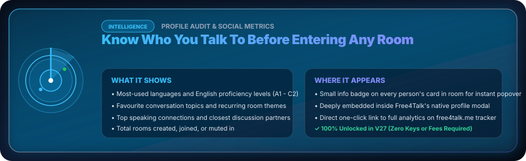
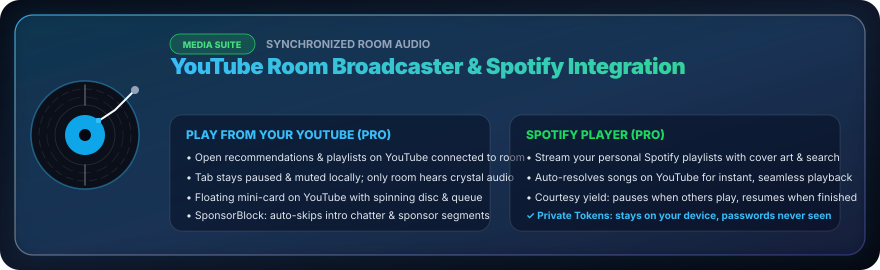
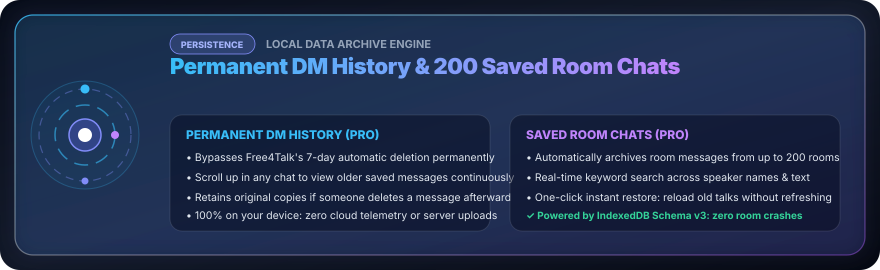
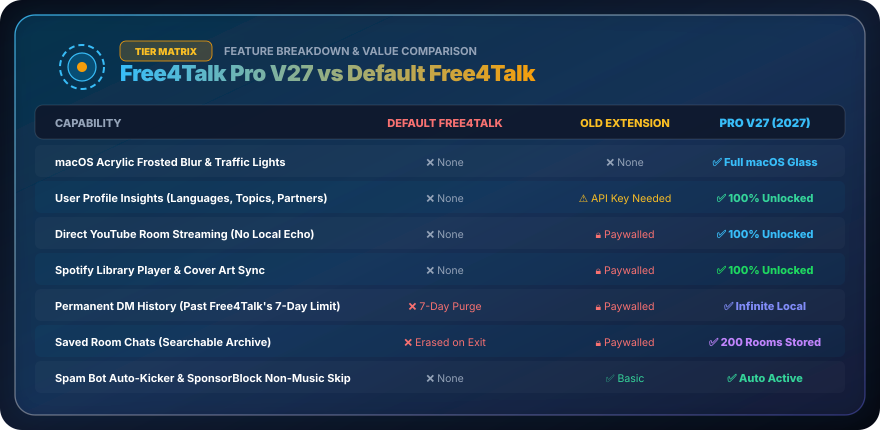
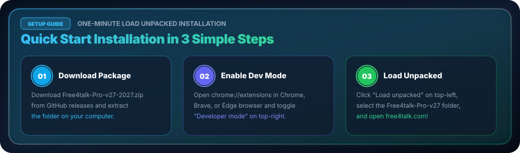
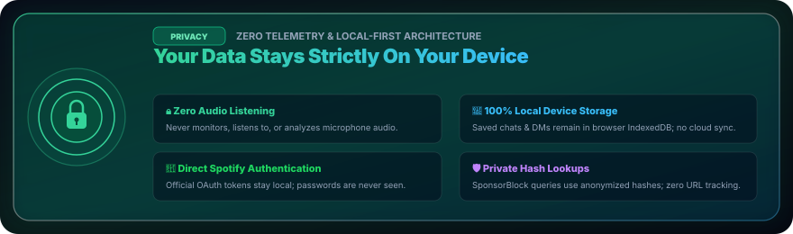
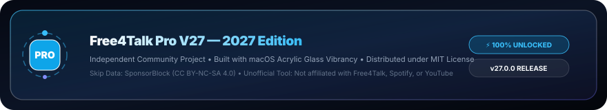

<!-- WEBSITE HEADER & NAVIGATION BAR -->
<table>
  <tr>
    <td align="center">
      <a href="#overview"><b>⚡ Overview</b></a> &nbsp;&bull;&nbsp;
      <a href="#interface"><b>🖥️ macOS Interface</b></a> &nbsp;&bull;&nbsp;
      <a href="#insights"><b>📊 User Insights</b></a> &nbsp;&bull;&nbsp;
      <a href="#media-suite"><b>🎵 Media Suite</b></a> &nbsp;&bull;&nbsp;
      <a href="#persistence"><b>💬 Chat Archives</b></a> &nbsp;&bull;&nbsp;
      <a href="#defense"><b>🛡️ Room Defense</b></a> &nbsp;&bull;&nbsp;
      <a href="#comparison"><b>⚖️ Tier Matrix</b></a> &nbsp;&bull;&nbsp;
      <a href="#installation"><b>📦 Installation</b></a> &nbsp;&bull;&nbsp;
      <a href="#privacy"><b>🔒 Privacy</b></a>
    </td>
  </tr>
</table>

<!-- SECTION 1: ANIMATED HERO BANNER WITH CIRCULAR TEXT RING & COLOR-CHANGING TITLE -->

  

<!-- ACTION CALL-TO-ACTION BUTTONS & DYNAMIC STATUS PILLS -->

  
  
  
  
  

  
  &nbsp;&nbsp;
  

<!-- SECTION 2: LIVE MACOS FROSTED GLASS INTERFACE MOCKUP -->

  

<!-- SECTION 3: USER PROFILE INTELLIGENCE (WHAT IT SHOWS / WHERE IT APPEARS) -->

  

<!-- SECTION 4: STREAMING MEDIA ENGINE (YOUTUBE STREAMER & SPOTIFY PLAYER) -->

  

<!-- SECTION 5: INFINITE PERSISTENCE (PERMANENT DM LOGS & 200 SAVED ROOM CHATS) -->

  

<!-- SECTION 6: ROOM DEFENSE, AUTOMATION & UTILITIES (SPAM SHIELD / WELCOME / LOBBY RUMBLE) -->

  

<!-- SECTION 7: FEATURE COMPARISON & TIER MATRIX -->

  

<!-- SECTION 8: 3-STEP QUICK START INSTALLATION WORKFLOW -->

  

<!-- SECTION 9: ZERO-TELEMETRY & LOCAL-FIRST SECURITY ARCHITECTURE -->

  

<!-- SECTION 10: WEBSITE FOOTER & COPYRIGHT -->

