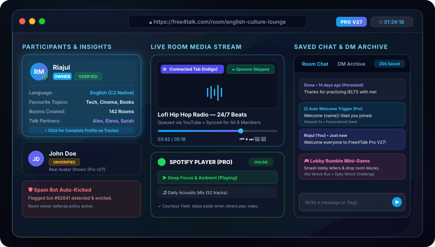

<!-- WEBSITE NAVIGATION BAR -->
<table>
  <tr>
    <td align="center">
      <a href="#overview"><b>Overview</b></a> &nbsp;&bull;&nbsp;
      <a href="#macos-interface"><b>Interface</b></a> &nbsp;&bull;&nbsp;
      <a href="#features"><b>Features</b></a> &nbsp;&bull;&nbsp;
      <a href="#pro-suite"><b>Pro Suite</b></a> &nbsp;&bull;&nbsp;
      <a href="#comparison"><b>Tier Comparison</b></a> &nbsp;&bull;&nbsp;
      <a href="#installation"><b>Installation</b></a> &nbsp;&bull;&nbsp;
      <a href="#privacy"><b>Privacy</b></a> &nbsp;&bull;&nbsp;
      <a href="#faq"><b>FAQ</b></a>
    </td>
  </tr>
</table>

<!-- HERO SECTION: ANIMATED SVG BANNER -->

  

<!-- DYNAMIC PRODUCT PILLS & BADGES -->

  
  
  
  
  

<!-- ACTION CALL-TO-ACTION BUTTONS -->

  
  &nbsp;&nbsp;
  

<!-- HIGHLIGHTS / METRICS STRIP -->
<table>
  <tr>
    <td align="center" width="25%">
      <h3><code>200+</code></h3>
      
<b>Saved Room Chats</b> Persistent history archive

    </td>
    <td align="center" width="25%">
      <h3><code>100%</code></h3>
      
<b>Pro Features Unlocked</b> Zero keys or paywalls needed

    </td>
    <td align="center" width="25%">
      <h3><code>∞ Days</code></h3>
      
<b>Direct Message Retention</b> Stored on physical device

    </td>
    <td align="center" width="25%">
      <h3><code>0 ms</code></h3>
      
<b>Audio Tracking</b> Strictly zero analytics &amp; ads

    </td>
  </tr>
</table>

---

## 🖥️ Next-Gen macOS Frosted Glass Interface

Free4Talk Pro V27 transforms the default interface into an authentic macOS acrylic experience. Translucent backdrop blurs, floating traffic lights, glowing neon toggles, and live widgets seamlessly blend into Free4Talk rooms.

  

---

## 🌟 Overview &amp; Experience

**Free4talk-Pro-v27 Tools** adds intelligent profile metrics and powerful media capabilities to Free4Talk, allowing you to know exactly who you are about to talk to before you enter any room. 

Stream synchronized music directly from your personal YouTube recommendations or Spotify account to everyone in the room, maintain an infinite direct message archive on your device beyond Free4Talk’s 7-day expiration, save full chat histories across 200 rooms, and automatically greet newcomers the moment they join.

---

## 💎 What It Shows &amp; Where It Appears

<table>
  <tr>
    <td width="50%" valign="top">
      <h3>📊 WHAT IT SHOWS</h3>
      
Gain instant conversational context on any member before talking:

      <ul>
        <li><b>Most-used languages &amp; English proficiency:</b> Identify language levels (A1 through C2 Native) at a glance.</li>
        <li><b>Favourite room topics:</b> Know their preferred conversation themes, from tech to casual banter.</li>
        <li><b>Top conversation partners:</b> View the people they converse with most frequently.</li>
        <li><b>Room activity metrics:</b> Exact counts of rooms created, joined, or muted in.</li>
      </ul>
    </td>
    <td width="50%" valign="top">
      <h3>📍 WHERE IT APPEARS</h3>
      
Naturally integrated into your normal browsing workflow:

      <ul>
        <li><b>Instant Info Button:</b> A small info pill on every person's participant card inside a room. Click for an immediate summary popover.</li>
        <li><b>Native Profile Dialog:</b> Cleanly injected inside Free4Talk’s default profile modal window.</li>
        <li><b>Full Tracker Link:</b> A direct one-click shortcut to view complete historical analytics on the <code>free4talk.me</code> tracker.</li>
      </ul>
    </td>
  </tr>
</table>

---

## 🚀 Pro Feature Deep Dive

<!-- ROW 1: YOUTUBE & SPOTIFY -->
<table>
  <tr>
    <td width="50%" valign="top">
      

        
        <h3>🎵 Play From Your YouTube</h3>
      

      
Pick music on YouTube itself (your recommendations, Mixes, playlists, or liked videos) and broadcast it directly to your Free4Talk room.

      <ul>
        <li><b>Connected Tab Sync:</b> A dedicated button in the room opens a synced YouTube tab wearing a distinct indigo badge.</li>
        <li><b>Zero Local Echo:</b> The YouTube tab stays paused and muted on your device; only the room hears the audio stream.</li>
        <li><b>Seamless Queues:</b> Click <b>+</b> on any video thumbnail to queue songs, or queue full Mixes in one click.</li>
        <li><b>Floating Mini-Controller:</b> Drag the player anywhere on your screen or minimize it into a compact spinning disc.</li>
        <li><b>Timeline Sync:</b> Scrub the YouTube progress bar and the room audio instantly jumps to the identical second.</li>
      </ul>
    </td>
    <td width="50%" valign="top">
      

        
        <h3>🎧 Spotify Player Integration</h3>
      

      
Connect your personal Spotify library and stream entire playlists to the room through Free4Talk's built-in playback system.

      <ul>
        <li><b>Full Cover Art Browsing:</b> Browse all your playlists, search track titles, and view high-resolution album artwork.</li>
        <li><b>Smart YouTube Resolution:</b> Automatically matches Spotify tracks on YouTube behind the scenes for seamless room playback.</li>
        <li><b>Smart Queue Controls:</b> Shuffle, repeat, Play all, and smart suggestions for related music.</li>
        <li><b>Courtesy Pause:</b> When someone else in the room plays a video, your playlist steps aside and resumes automatically when they finish.</li>
        <li><b>Direct Token Security:</b> Connects directly to Spotify's API; your password and credentials remain private on your device.</li>
      </ul>
    </td>
  </tr>
</table>

<!-- ROW 2: DM HISTORY & SAVED CHATS -->
<table>
  <tr>
    <td width="50%" valign="top">
      

        
        <h3>💬 Permanent DM History</h3>
      

      
Free4Talk automatically erases direct messages after 7 days. Free4talk Pro keeps them safely preserved on your physical machine.

      <ul>
        <li><b>Continuous Chat Thread:</b> Scroll to the top of any DM, and your saved older messages populate right above seamlessly with no extra windows.</li>
        <li><b>Deleted Message Retention:</b> If a message is deleted after being cached, you still retain the original marked as <i>deleted</i>.</li>
        <li><b>Automatic Sync:</b> Messages are stored as Free4Talk loads them, creating an effortless backup of every friend interaction.</li>
        <li><b>Zero Cloud Uploads:</b> Direct messages never touch any external server—everything resides in your browser's local database.</li>
      </ul>
    </td>
    <td width="50%" valign="top">
      

        
        <h3>📦 Saved Room Chats (200 Rooms)</h3>
      

      
Free4Talk erases room discussions the instant you exit. Free4talk Pro remembers conversations from up to 200 rooms.

      <ul>
        <li><b>Structured Archive:</b> Browse past conversations tagged with the room's language, topic, and message preview.</li>
        <li><b>Instant Keyword Search:</b> Search historical records by who was talking or specific phrases mentioned.</li>
        <li><b>One-Click Restore:</b> Bring a past conversation back into your active room view instantly with zero page reloads.</li>
        <li><b>Robust Schema v3:</b> Powered by an updated IndexedDB architecture that guarantees reliable offline storage.</li>
      </ul>
    </td>
  </tr>
</table>

<!-- ROW 3: SPONSORBLOCK & SPAM DEFENSE -->
<table>
  <tr>
    <td width="50%" valign="top">
      

        
        <h3>⏩ Skip Non-Music Segments</h3>
      

      
Music videos frequently start with cinematic dialogues and end with credits. Turn on <b>"Skip non-music parts"</b> and videos leap straight past chatter for everyone in the room.

      <ul>
        <li><b>Powered by SponsorBlock:</b> Leverages crowdsourced community timecodes.</li>
        <li><b>Privacy-Preserving Hashes:</b> Queries SponsorBlock using only truncated video hashes—the service never receives your video URL or title.</li>
        <li><b>Universal Room Sync:</b> All participants experience the skip simultaneously.</li>
      </ul>
    </td>
    <td width="50%" valign="top">
      

        
        <h3>🛡️ Kick Spam Bots &amp; Auto Kick</h3>
      

      
Protect your conversations from intrusive advertising bots and disruptive room-hopping accounts.

      <ul>
        <li><b>Live Tracker Detection:</b> Cross-references flagged bots and kicks them the instant they enter a room you own.</li>
        <li><b>Auto Kick (Pro):</b> Maintain custom blocklists by user ID or exact handle.</li>
        <li><b>Safe Whitelist:</b> Room owners, co-owners, and invited guests are immune to automated kicks.</li>
        <li><b>Friend Filters:</b> Option to auto-kick unverified accounts or anyone outside your friend list.</li>
      </ul>
    </td>
  </tr>
</table>

<!-- ROW 4: WELCOME GREETINGS, AVATARS, LOBBY RUMBLE -->
<table>
  <tr>
    <td width="33%" valign="top">
      

        
        <h4>👋 Welcome Greetings</h4>
      

      
Greet joining members with customized greetings. Use <code>{name}</code> to mention them by name. Features configurable delay (2s to 60s) and separate welcome-back messages for returning peers.

    </td>
    <td width="33%" valign="top">
      

        
        <h4>🖼️ Unverified Avatars</h4>
      

      
Replaces default initials on unverified profiles with their authentic uploaded picture, while keeping a clean "unverified" safety label so you always stay informed.

    </td>
    <td width="33%" valign="top">
      

        
        <h4>🎮 Lobby Rumble</h4>
      

      
Turn lobby waiting into interactive fun! Click the controller button on the homepage to pop letters, shatter buttons, and topple room cards in a 45-second Wreck Run or untimed Free Wreck.

    </td>
  </tr>
</table>

---

## ⚖️ Feature Comparison Matrix

| Feature Capability | Default Free4Talk | Standard Extension | Free4Talk Pro V27 (2027) |
| :--- | :---: | :---: | :---: |
| **macOS Frosted Glass Blur & Traffic Lights** | ❌ None | ❌ None | **✅ Included (Built-in)** |
| **User Profile Language & Topic Insights** | ❌ None | ⚠️ API Key Needed | **✅ Permanently Unlocked** |
| **Direct YouTube Room Streaming** | ❌ None | 🔒 Pro Subscription | **✅ 100% Unlocked** |
| **Spotify Player with Queue & Artwork** | ❌ None | 🔒 Pro Subscription | **✅ 100% Unlocked** |
| **Direct Message History (Beyond 7 Days)** | ❌ 7-Day Purge | 🔒 Pro Subscription | **✅ Unlimited Local Archive** |
| **Saved Room Chats Archive** | ❌ Erased on Exit | 🔒 Pro Subscription | **✅ Up to 200 Rooms** |
| **Skip Non-Music Video Parts (SponsorBlock)** | ❌ None | ✅ Free | **✅ Zero-Lag Hash Query** |
| **Spam Bot Auto-Kicker** | ❌ None | ✅ Free | **✅ Real-Time Tracker Sync** |
| **Custom Auto-Kick Blocklists** | ❌ None | 🔒 Pro Subscription | **✅ 100% Unlocked** |
| **Automated Welcome & Return Greetings** | ❌ None | ✅ Free | **✅ Smart Delay Engine** |
| **Unverified Avatar Photo Reveal** | ❌ Initials Only | ✅ Free | **✅ Full Resolution** |
| **Lobby Rumble Physics Game** | ❌ None | ✅ Free | **✅ 3 Game Modes** |
| **Room Elapsed Call Timer** | ❌ None | ✅ Free | **✅ Discreet Call Bar** |

---

## 📦 Quick Installation Guide

<table>
  <tr>
    <td width="33%" align="center">
      <h3>Step 1</h3>
      
<b>Download Package</b>

      
Download <a href="https://github.com/Riajul18-19/free4talk-pro/releases/tag/v27.0.0"><code>Free4talk-Pro-v27-2027.zip</code></a> and extract the folder to your computer.

    </td>
    <td width="33%" align="center">
      <h3>Step 2</h3>
      
<b>Enable Developer Mode</b>

      
Open <code>chrome://extensions</code> in Chrome, Brave, or Edge and toggle <b>Developer mode</b> on the top right.

    </td>
    <td width="33%" align="center">
      <h3>Step 3</h3>
      
<b>Load Extension</b>

      
Click <b>Load unpacked</b> and select the extracted <code>Free4talk-Pro-v27</code> folder. Open <a href="https://free4talk.com">free4talk.com</a> and enjoy!

    </td>
  </tr>
</table>

---

## 🔒 Privacy &amp; Local-First Architecture

Free4Talk Pro V27 is engineered with a strict **zero-telemetry, local-first** standard:

- **No Listening or Audio Access:** The extension never monitors, records, or analyzes microphone or audio stream feeds.
- **Strictly Local Storage:** All saved room chats and direct messages remain stored exclusively in your browser’s local IndexedDB database. They are never sent, uploaded, or synced to any cloud server.
- **Isolated YouTube Access:** Operates on `free4talk.com`, and accesses `youtube.com` only when you explicitly connect a tab to play music.
- **Direct Spotify Authentication:** Token exchanges occur directly with Spotify's official servers. Your Spotify password and authentication tokens never leave your local browser session.
- **Private SponsorBlock Lookups:** Skip intervals are retrieved using truncated, anonymized hashes of video IDs. SponsorBlock never receives the URL, title, or user metadata of what you listen to.

---

## ❓ Frequently Asked Questions

  
<b>Do I need to pay for Pro in Version 27?</b>

   
  No. Version 27 has all Pro features permanently unlocked out of the box. You do not need any active subscription, recurring payment, or external purchase.

  
<b>How does YouTube streaming work without echoing?</b>

   
  When you connect a YouTube tab, Free4Talk Pro mutes and pauses the tab on your local system, relaying playback commands directly through Free4Talk’s synchronized room room player. This ensures crystal-clear audio for all participants with zero feedback.

  
<b>What happens if a room chat or DM is deleted?</b>

   
  Because Free4talk Pro saves chat messages locally as they arrive, any message deleted afterward on Free4Talk remains intact in your local archive, marked with a discrete <i>(Saved / Deleted)</i> label.

  
<b>Is Free4Talk Pro compatible with other Chromium browsers?</b>

   
  Yes! Free4Talk Pro runs smoothly on Google Chrome, Brave, Microsoft Edge, Opera, Vivaldi, Arc, and any browser supporting Manifest V3 extension standards.

---

## ⚖️ Disclaimer &amp; Credits

**Free4talk-Pro-v27 Tools** is an independent, community-developed enhancement tool. It is not affiliated with, endorsed, sponsored, or supported by Free4Talk, Spotify, YouTube, or SponsorBlock.  
- Skip Data: Powered by [SponsorBlock](https://sponsor.ajay.app) (Licensed under CC BY-NC-SA 4.0).  
- Icons &amp; Design: Crafted with macOS design guidelines and FontAwesome icons.

---

<!-- WEBSITE FOOTER -->
<table>
  <tr>
    <td align="center">
       
      <b>Free4Talk Pro V27 — 2027 Edition</b> 
      Independent Open-Source Community Project &bull; Distributed under MIT License  
      <a href="https://github.com/Riajul18-19/free4talk-pro">GitHub Repository</a> &nbsp;&bull;&nbsp;
      <a href="https://github.com/Riajul18-19/free4talk-pro/releases/tag/v27.0.0">Releases (v27.0.0)</a> &nbsp;&bull;&nbsp;
      <a href="index.html">Web Showcase</a> &nbsp;&bull;&nbsp;
      <a href="#overview">Back to Top ↑</a>
    </td>
  </tr>
</table>

